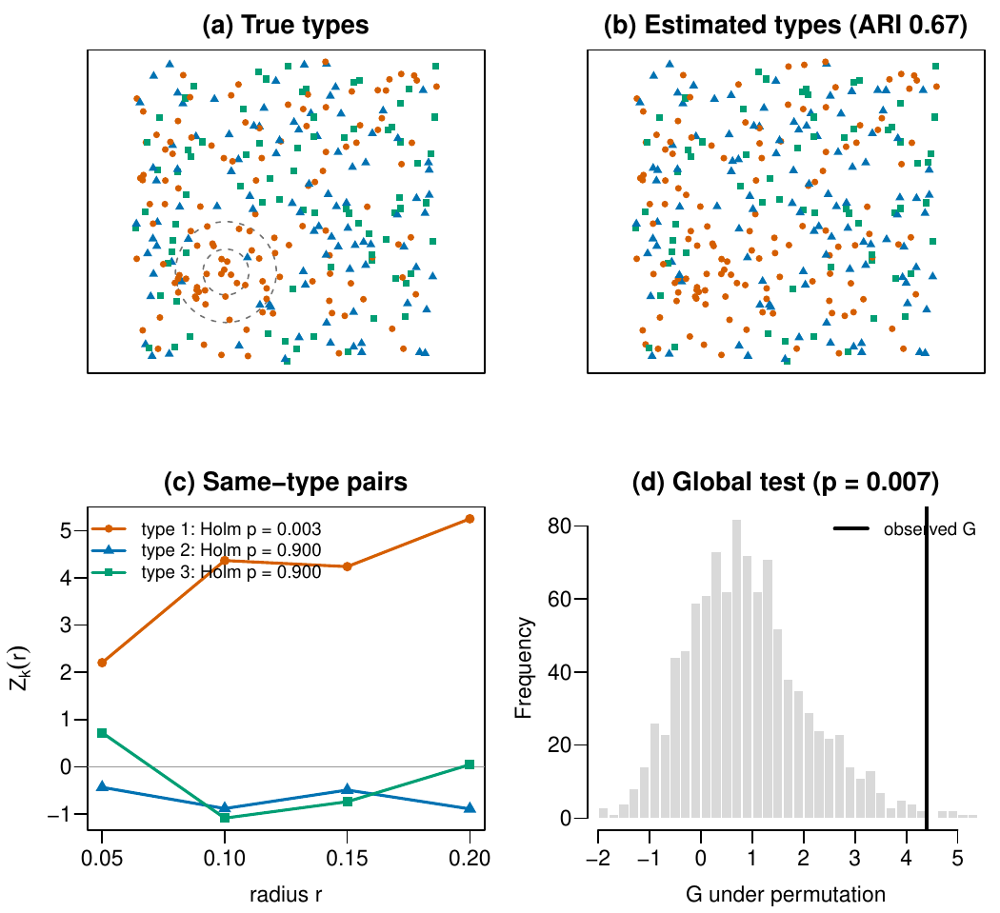

# FCST: testing the spatial concentration of estimated shape types

R code for the paper

> G. Sottile, M. D'Antoni and G. Adelfio. *Testing the spatial concentration of
> estimated shape types in functional marked point patterns.* Submitted to
> *Spatial Statistics*.

The **functional clustering spatial test (FCST)** asks whether the shape of the
curve carried by each event of a spatial point pattern (for instance, the
seismogram of an earthquake) is informative about where the event occurs, and,
if so, **which shape types are concentrated and at which spatial scale**. The
curves are first reduced to estimated types by any clustering method that does
not use the locations; the spatial arrangement of the types is then examined by
multi-scale counts of same-type pairs of nearby events, calibrated by random
permutations of the labels. The test is exact in finite samples whatever the
clustering method, attributes a rejection to individual types with strong
control of the family-wise error rate, calibrates several clusterings jointly,
and adjusts for spatially structured covariates by restricted permutations.

The repository contains the implementation (a single R file, base R only for
the core), a short example, and every script used for the simulation study and
the application, together with the results and the tables and figures of the
paper.

---

## Quick start

```bash
git clone https://github.com/gianluca-sottile/fcst.git
cd fcst/examples
```

```r
source("quick_example.R")   # in R, from the folder examples/
```

The example simulates 300 events with three curve types, one of which is
concentrated in a hotspot, clusters the noisy curves, and runs the test:
global $p$-value, type-specific $p$-values with Holm's adjustment, joint test
over two clusterings and a test restricted to strata of a covariate. It runs in
well under a minute and draws a four-panel figure (`examples/quick_example.pdf`):
the true and the estimated types on the map, the standardised same-type
statistics $Z_k(r)$ by radius for each type with the Holm-adjusted $p$-values,
and the permutation distribution of the global statistic with its observed
value.



In this example the clustering of the noisy curves is imperfect (adjusted Rand
index 0.67), yet random labelling is rejected ($p = 0.007$) and the rejection
is attributed to the type concentrated in the hotspot (Holm-adjusted
$p = 0.003$), while the other two types are not concentrated ($p = 0.90$).

### Using FCST on your own data

```r
source("R/fcst_methods.R")

# X: n x 2 matrix of coordinates; Y: n x T matrix of curves on a common grid
labels <- type_curves(Y, K = 3, representation = "spectrum", algorithm = "fpca_kmeans")
res <- fcst_test(X, labels, scales = c(1, 2, 5, 10), B = 999)

res$p_global   # test of random labelling
res$table      # one row per type: statistic, raw, Holm-adjusted and max-T p-values
```

* `labels` may be any vector of cluster labels computed **from the curves only**
  (`0` = unassigned), or a matrix with one column per clustering: all columns are
  permuted together and `res$p_global` is then the joint test over the
  clusterings.
* `scales` are the radii, in the units of `X`.
* `strata = ` a vector of strata (for instance `make_strata(z, n_bins = 3)` for a
  covariate `z`) gives the covariate-adjusted test.
* `kernel = "gaussian"` and `weights = "inverse_intensity"` are available.
* `progress = TRUE` prints the progress of the permutations.

---

## Repository layout

```
R/                     all scripts (run them with R/ as working directory)
  fcst_methods.R       the method: simulation tools, representations, clustering,
                       pair statistics, exact permutation moments, fcst_test()
  fcst_competitors.R   competing tests (segregation, multinomial scan, functional
                       scan, mark-weighted K-function, distance covariance)
  plot_style.R         common graphical style of the figures
  sim_*.R              simulation study
  app_*.R              application to the STEAD earthquake data
  make_*.R             tables (LaTeX) and figures (PDF) from the results
  results/             results of all simulations and of the application (CSV)
output/
  tables/, figures/    tables and figures of the paper, as produced by the scripts
examples/
  quick_example.R      minimal example
install_packages.R     installs the packages used by the scripts
```

## Requirements

R (>= 4.1). The core of the method (`fcst_methods.R`) uses base R only. The
scripts use the following packages, all optional for the core:

| package | used for |
| --- | --- |
| `mclust` | Gaussian mixture clustering |
| `cluster` | partitioning around medoids, silhouette |
| `tclust` | trimmed k-means |
| `clustEff` | FPCAC and shape-distance clustering (Section 6.2) |
| `data.table`, `rhdf5` (Bioconductor), `signal` | reading and filtering the STEAD waveforms |
| `GET` | global envelope test (`sim_09`) |
| `maps` | state borders in the map of the data |

`source("install_packages.R")` installs them.

---

## Reproducing the paper

All scripts are run from the `R/` folder (`setwd("R")`). The results of every
simulation are already in `R/results/`, so the tables and figures can be
rebuilt in a few seconds without running the simulations again:

```r
setwd("R")
source("make_tables_figures.R")   # tables and figures of the simulation study
source("make_design_figures.R")   # figures of the simulation design
```

### Simulation study (Section 6 and Supplementary Material)

Each replicate has its own seed, so results do not depend on the number of
cores (`n_cores` at the top of each script; values > 1 use forked processes
on macOS and Linux). With the settings of the paper the simulations take from a
few minutes (`sim_00`, `sim_07`) to several hours (`sim_01`, `sim_02`, `sim_05`,
`sim_08`) on a desktop computer.

| script | content | output files | in the paper |
| --- | --- | --- | --- |
| `sim_00_check_moments.R` | closed-form permutation moments against Monte Carlo | -- | Section S2 |
| `sim_01_size.R` | size under random labelling (36 settings) | `tab_size`, `tab_size_full` | Table 1, Table S8 |
| `sim_02_power.R` | power, pair vs centroid statistic, attribution | `fig_power`, `tab_power_full_body` | Figure 2, Table S7 |
| `sim_03_misclassification.R` | attenuation identity under misclassification | `tab_misclass` | Section 6.2, Table S1 |
| `sim_04b_confounding_scenarios.R` | spatially structured covariates, five scenarios | `tab_confounding_scenarios` | Table 3 |
| `sim_05_competitors.R` | comparison with competing tests | `fig_competitors`, `tab_competitors_full` | Figure 3, Table S9 |
| `sim_05b_segregation_cv.R` | segregation test with cross-validated bandwidth | `tab_segregation_cv` | Table S3 |
| `sim_06_typings.R` | several clusterings and joint calibration | `tab_typings` | Table 2 |
| `sim_07_normal_approx.R` | normal approximation of the permutation distribution | -- | Section S4 |
| `sim_08_robustness.R` | point process, hotspot profile and pair weights | `tab_robustness*`, `fig_design_robust` | Section S7, Table S4 |
| `sim_09_attribution.R` | attribution to types: FCST vs global envelope test (GET) and nearest-neighbour test | `tab_attribution` | Section 6.3, Table S5 |
| `sim_10_semisynthetic.R` | real STEAD waveforms at simulated locations (needs `app_01`, `app_02`) | `tab_semisynthetic` | Section 6.1, Table S6 |
| `make_design_figures.R` | illustrations of the design and of confounding | `fig_design_space`, `fig_design_curves`, `fig_confounding`, `fig_design_robust` | Figure 1, Figures S1–S3 |

### Application (Section 7)

The data are from the Stanford Earthquake Dataset (STEAD; Mousavi et al., 2019,
*IEEE Access* 7, 179464–179476), distributed under a CC BY 4.0 licence at
<https://github.com/smousavi05/STEAD>. They are not included here because of
their size. Two ways to obtain them:

* **SeisBench** (used for the paper): in Python (3.12 recommended),
  `pip install seisbench`, then `python -c "import seisbench.data as sbd; sbd.STEAD()"`;
  the data are written to `~/.seisbench/datasets/stead/`. Then run
  `app_00_extract_seisbench.R`.
* **Original chunks**: `bash download_stead.sh` downloads chunks 2–6, extracts
  the selected traces with `app_00_extract_chunk.R` and deletes each chunk.

The selection is: local earthquakes with epicentres in 45–47° N, 123–121° W,
short-period channels (`EH`) and duration magnitude (`MD`): 8038 traces of 3524
events at 24 stations. Then:

| script | content | output files | in the paper |
| --- | --- | --- | --- |
| `app_01_prepare_stead.R` | one vertical trace per event, coordinates in km, covariates | `results/app_stead_station_counts.csv` | Section 7.1 |
| `app_02_fcst_stead.R` | eight clusterings, joint, distance-and-magnitude and station-restricted tests (about 25 minutes) | `tab_app_tests`, `tab_app_types` | Table 4, Table S11 |
| `app_03_data_map.R` | map of the data | `fig_app_data` | Figure 4 |
| `app_04_competitors_stead.R` | competing tests on the same data (about 25 minutes) | `tab_app_competitors` | Table 5 |
| `app_05_figures_stead.R` | maps and spectra of the types | `fig_app_map`, `fig_app_curves` | Figures 5–6 |
| `app_06_robustness_stead.R` | strata with time, single station, other window/representation/strata/radii, cross-correlation (needs the SeisBench extract) | `tab_app_robustness`, `tab_app_xcorr` | Section 7.3, Tables S12–S13 |

`app_04`, `app_05`, `app_06` and `sim_10` reuse the data prepared by `app_01`
(`results/app_stead_data.rds`, not included because derived from STEAD) and the
clusterings saved by `app_02` (`results/app_stead_labels.rds`, included), so
they do not repeat the clustering.

---

## Citation

If you use this code, please cite the paper (see `CITATION.cff`):

```
Sottile, G., D'Antoni, M., Adelfio, G. (2026). Testing the spatial concentration
of estimated shape types in functional marked point patterns. Submitted to
Spatial Statistics.
```

## Funding

Targeted Research Funds 2026 (FFR 2026) of the University of Palermo; PRIN 2022
project "Spatio-temporal Functional Marked Point Processes for probabilistic
forecasting of earthquakes" (2022BN7CJP, P.I. Giada Adelfio, CUP
B53C24006340006).

## License

The code is released under the MIT License (see `LICENSE`). The STEAD data are
subject to their own CC BY 4.0 licence.
